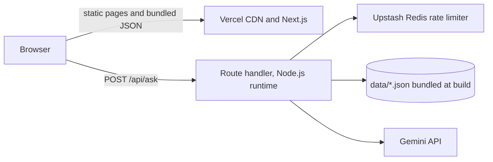

# Flame in Freefall — Technical Specification

| Field | Value |
|---|---|
| Document ID | FIF-SPEC-001 |
| Version | 1.0 |
| Date | 2026-11-14 |
| Product | Flame in Freefall: Investigation Explorer and Relevance Ranker |
| Product owner | Bharath |
| Companion documents | `scope.md` (boundary), `prd.md` (requirements, copy strings, golden questions), `checklist.md` (tasks) |

**How to use this document.** Sections 1 to 10 define the system. Section 11 breaks the build into 30 small steps (S-01 to S-30). Each step names its files, its work and a "done when" check, ends in one commit, and leaves the app deployable. Build the steps in order inside a phase; steps without a dependency on each other may run in parallel across people. Requirement IDs (`FR-…`, `NFR-…`) refer to `prd.md`.

**Wording.** "Shall" is mandatory. Where this document chooses a value the PRD left open, the choice is marked **Decision** and is final unless the product owner changes it.

---

## 1. System overview



| Concern | Where it runs | Notes |
|---|---|---|
| Data (13 records, environments, Earth links) | Bundled at build from `data/*.json`, validated by Zod | No runtime call to PSI or any NASA host (FR-DAT-05) |
| Filtering, sorting, scoring, compare, export | Browser, pure functions in `lib/` | No network request on slider or filter change |
| AI Q&A | Server only: `POST /api/ask`, Node.js runtime | Only route with a server dependency; the only user of Gemini and Upstash |
| Static routes | Vercel CDN | `/`, `/investigations/[id]`, `/compare`, `/about`, `/earth`, `/coverage`, `/ask` shell |

**Principles.**
1. One schema (Zod) validates data files at build, the API request body and the model output.
2. Every number the user sees comes from a pure function with a unit test.
3. The model never produces a verification label, a confidence label, a fixed message or an extrapolation flag that the server does not overwrite or confirm.
4. Failure of Gemini or Upstash affects only `/ask` and `/api/ask` (NFR-REL-01).

## 2. Stack and tooling

| Layer | Choice | Rule |
|---|---|---|
| Runtime | Node.js active LTS (22 or later) | Pinned in `.nvmrc` and `engines` |
| Framework | Next.js, App Router, TypeScript `strict` | Latest stable at hour 0; exact versions pinned in `package.json` (no `^`) |
| Styling | Tailwind CSS | Tokens from `prd.md` section 5.2 mapped in `tailwind.config.ts` |
| Validation | Zod 4 | `z.toJSONSchema()` produces the Gemini response schema |
| AI SDK | `@google/genai` | Server only; imported only under `lib/ai/` and `app/api/` |
| Rate limiting | `@upstash/ratelimit` and `@upstash/redis` | Upstash Redis through the Vercel Marketplace |
| Unit and component tests | Vitest, `@vitest/coverage-v8`, `@testing-library/react`, `@testing-library/user-event`, `jsdom` | |
| Scripts | `tsx` | Runs `scripts/*.ts` |
| Lint | ESLint with `eslint-config-next` | `npm run lint` |
| CI | GitHub Actions `.github/workflows/ci.yml` | Steps: install, lint, typecheck, test with coverage, `npm audit --omit=dev --audit-level=high`, build, gitleaks |
| Hosting | Vercel | Production deploys from `main` |

**npm scripts (final set).**

| Script | Command | Purpose |
|---|---|---|
| `dev` | `next dev` | Local server |
| `prebuild` | `tsx scripts/validate-data.ts` | Fails the build on any data violation (FR-DAT-02) |
| `build` | `next build` | Production build |
| `start` | `next start` | Serve the build |
| `lint` | `eslint .` | |
| `typecheck` | `tsc --noEmit` | |
| `test` | `vitest run` | Unit and component tests |
| `test:coverage` | `vitest run --coverage` | Enforces 90% lines on `lib/scoring.ts` and `lib/ai/validate.ts` |
| `test:export` | `vitest run tests/export.test.ts && python3 tests/export-python/check.py` | Python load check (O-4) |
| `data:validate` | `tsx scripts/validate-data.ts` | Zod validation only |
| `data:report` | `tsx scripts/data-report.ts` | Curation report (section 4.6) |
| `golden` | `tsx scripts/golden.ts` | Golden-set run (step S-20) |

## 3. Repository layout

```
/app
  layout.tsx                 root layout: Header, Banner, Footer, CompareProvider
  page.tsx                   / Explorer (server component; renders <ExplorerClient/> inside <Suspense>)
  investigations/[id]/page.tsx   detail; generateStaticParams from data; dynamicParams = false
  compare/page.tsx           /compare (client component inside <Suspense>)
  ask/page.tsx               /ask
  about/page.tsx             /about
  earth/page.tsx             /earth          (Should)
  coverage/page.tsx          /coverage       (Could)
  not-found.tsx              404 page
  api/ask/route.ts           POST /api/ask
/components                  Header, Footer, Banner, StatusBadge, PillarChip, WeightPanel, FilterBar,
                             InvestigationTable, InvestigationCards, ScoreBreakdown, CompareTray,
                             CompareTable, ExportButtons, AskForm, AnswerView, EvidencePanel,
                             EarthList, CoverageGrid
/config                      scoring.ts, extrapolation-keywords.ts
/data                        investigations.json, environments.json, earth-applications.json
/lib                         schema.ts, data.ts, scoring.ts, explorer.ts, compare.ts, coverage.ts,
                             export.ts, copy.ts
/lib/ai                      augment.ts, response-schema.ts, system-prompt.ts, validate.ts,
                             pipeline.ts, client.ts, confidence.ts, extrapolation.ts
/lib/server                  ratelimit.ts, ip.ts, log.ts
/docs                        export-format.md, curation-checklist.md, demo/
/scripts                     validate-data.ts, data-report.ts, golden.ts, gemini-smoke.ts
/tests                       data, scoring, explorer, compare, coverage, export, validate, pipeline,
                             ask-route, env-flags, copy, ui-states, export-python/check.py, fixtures/
```

## 4. Data model

### 4.1 Schema (`lib/schema.ts`)

This file is the single source of truth for types. TypeScript types are derived with `z.infer`.

```ts
import { z } from "zod";

export const RECORD_IDS = [
  "bass", "bass-ii", "saffire-i", "saffire-ii", "saffire-iii",
  "same", "same-r", "daft", "daft-2", "flex", "flex-2", "cfi", "acme",
] as const;

export const VERIFIABLE_FIELDS = [
  "pillar", "facility", "hardware", "objective", "fuels", "diluents",
  "o2_pct", "pressure_psi", "airflow", "gravity_regime", "variables_varied", "sensors",
] as const;
export type VerifiableField = (typeof VERIFIABLE_FIELDS)[number];

export const VerificationSchema = z.enum(["verified", "unverified", "not_available"]);
export type Verification = z.infer<typeof VerificationSchema>;

const nonNeg = z.number().finite().min(0);
const text = z.string().trim().min(1);

export const FuelSchema = z.object({
  name: text,
  form: z.enum(["solid", "liquid_droplet", "gas", "dust", "other"]),
}).strict();

export const SourceSchema = z.object({
  title: text,
  url: z.string().url(),
  kind: z.enum(["psi", "ntrs", "nasa_page", "paper", "other"]),
}).strict();

export const RecordSchema = z.object({
  id: z.enum(RECORD_IDS),
  name: text,
  full_name: text.nullable(),
  pillar: z.array(z.enum(["prevention", "detection", "suppression", "unassigned"])).min(1),
  facility: z.enum(["CIR", "MSG", "other", "not_stated"]),
  hardware: z.array(text),
  objective: z.string().trim().min(1).max(400).nullable(),
  fuels: z.array(FuelSchema),
  diluents: z.array(text),
  o2_min_pct: z.number().min(0).max(100).nullable(),
  o2_max_pct: z.number().min(0).max(100).nullable(),
  pressure_min_psi: nonNeg.nullable(),
  pressure_max_psi: nonNeg.nullable(),
  airflow: z.object({ min: nonNeg.nullable(), max: nonNeg.nullable(), unit: text.nullable() }).strict(),
  gravity_regime: z.array(z.enum(["microgravity", "normal_gravity", "partial_gravity"])),
  variables_varied: z.array(text),
  sensors: z.array(text),
  sub_experiments: z.array(text),
  psi_url: z.string().url().nullable(),
  sources: z.array(SourceSchema),
  verification: z.object(
    Object.fromEntries(VERIFIABLE_FIELDS.map((f) => [f, VerificationSchema])) as
      Record<VerifiableField, typeof VerificationSchema>
  ).strict(),
  last_curated_at: z.string().regex(/^\d{4}-\d{2}-\d{2}$/),
}).strict().superRefine(recordRules); // rules in section 4.2

export type InvestigationRecord = z.infer<typeof RecordSchema>;
export const InvestigationsFileSchema = z.array(RecordSchema).superRefine(uniqueIds);
```

`recordRules` and `uniqueIds` are implemented in the same file per section 4.2.

### 4.2 Validation rules (enforced by Zod `superRefine`)

| # | Rule | Failure message (exact prefix) |
|---|---|---|
| 1 | `o2_min_pct` and `o2_max_pct` are both null or both non-null; when both non-null, `min <= max` | `o2 pair:` |
| 2 | `pressure_min_psi` and `pressure_max_psi` follow rule 1 | `pressure pair:` |
| 3 | `airflow.min` and `airflow.max` follow rule 1; `airflow.unit` is non-null exactly when the bounds are non-null | `airflow:` |
| 4 | Status consistency, "not available" side: status `not_available` requires the value to be null, empty array, `not_stated` (facility) or `["unassigned"]` (pillar) | `status <field>:` |
| 5 | Status consistency, "present" side: status `verified` or `unverified` requires a non-null, non-empty value | `status <field>:` |
| 6 | Status `verified` on any field requires `sources.length >= 1` (FR-DAT-03) | `verified without source:` |
| 7 | `pillar` containing `unassigned` shall equal `["unassigned"]` exactly | `pillar:` |
| 8 | `gravity_regime` containing `partial_gravity` requires `verification.gravity_regime === "verified"` | `partial gravity:` |
| 9 | `id` values are unique across the file | `duplicate id:` |

**Decision.** A source-confirmed "no diluent" or "no variables varied" cannot be represented in this release; such a field is stored as `not_available`. Rules 4 and 5 make a status impossible to set without a value.

`scripts/validate-data.ts` additionally asserts the file contains exactly the 13 ids in `RECORD_IDS`, and that `data/environments.json` and `data/earth-applications.json` pass their schemas (sections 4.4 and 4.5). It prints each violation as `<file> <record id> <message>` and exits 1 on any violation.

### 4.3 Seed records (`data/investigations.json` initial content)

The seed holds only what the source report states (PRD Appendix A). Every seeded value has status `unverified`. Every other field is `null` or `[]` with status `not_available`. `sources` is `[]`. `last_curated_at` is `2026-11-14`. `full_name`, `objective`, `psi_url` are `null`. `sub_experiments` is `[]`. All O2, pressure and airflow fields are `null`.

| id | name | pillar (status) | facility (status) | hardware (status) | diluents (status) |
|---|---|---|---|---|---|
| `bass` | BASS | `["prevention"]` (unverified) | MSG (unverified) | `["SPICE-built flow duct"]` (unverified) | `[]` (not_available) |
| `bass-ii` | BASS-II | `["prevention"]` (unverified) | MSG (unverified) | `["SPICE-built flow duct"]` (unverified) | `[]` (not_available) |
| `saffire-i` | Saffire-I | `["prevention"]` (unverified) | `not_stated` (not_available) | `[]` (not_available) | `[]` (not_available) |
| `saffire-ii` | Saffire-II | `["prevention"]` (unverified) | `not_stated` (not_available) | `[]` (not_available) | `[]` (not_available) |
| `saffire-iii` | Saffire-III | `["prevention"]` (unverified) | `not_stated` (not_available) | `[]` (not_available) | `[]` (not_available) |
| `same` | SAME | `["detection"]` (unverified) | `not_stated` (not_available) | `[]` (not_available) | `[]` (not_available) |
| `same-r` | SAME-R | `["detection"]` (unverified) | `not_stated` (not_available) | `[]` (not_available) | `[]` (not_available) |
| `daft` | DAFT | `["detection"]` (unverified) | `not_stated` (not_available) | `[]` (not_available) | `[]` (not_available) |
| `daft-2` | DAFT-2 | `["detection"]` (unverified) | `not_stated` (not_available) | `[]` (not_available) | `[]` (not_available) |
| `flex` | FLEX | `["suppression"]` (unverified) | CIR (unverified) | `["MDCA"]` (unverified) | `["CO2","helium"]` (unverified) |
| `flex-2` | FLEX-2 | `["unassigned"]` (not_available) | CIR (unverified) | `["MDCA"]` (unverified) | `[]` (not_available) |
| `cfi` | CFI | `["unassigned"]` (not_available) | CIR (unverified) | `["MDCA"]` (unverified) | `[]` (not_available) |
| `acme` | ACME | `["unassigned"]` (not_available) | CIR (unverified) | `[]` (not_available) | `[]` (not_available) |

The Saffire pillar value `prevention` is mapped from "flammability of solids" and stays `unverified` until the curator checks a source (OQ-09). The report's "CFI-G with up to 85% oxygen" and "ACME: six gaseous-flame experiments" are curation leads, not seed values: the O2 pair is stored only after the curator reads it from a source, and `sub_experiments` is filled from a source. SPICE and SLICE (MSG hardware groups) are not records.

**Curation requirements that golden questions depend on.** `flex.diluents` shall hold CO2 and helium (G3). `fuels[].form` shall be set from a source for every record whose source states the fuel (G1). O2 and pressure pairs shall be curated for every record whose source states them (G7, G10).

### 4.4 Environment profiles (`data/environments.json`)

```json
[
  { "key": "iss", "label": "ISS", "enabled": true,
    "o2_pct": { "min": 21, "max": 21 }, "pressure_psi": { "min": 14.7, "max": 14.7 },
    "source": "Earth baseline in the challenge statement (A-05, OQ-03)" },
  { "key": "moon_base", "label": "Moon base", "enabled": true,
    "o2_pct": { "min": 30, "max": 100 }, "pressure_psi": { "min": 0, "max": 10.2 },
    "source": "Challenge statement: habitats at 30% oxygen or more and 10.2 psi or less" },
  { "key": "rover", "label": "Pressurized rover", "enabled": false,
    "o2_pct": null, "pressure_psi": null, "source": "No value in the report (OQ-02)" },
  { "key": "mars", "label": "Mars", "enabled": false,
    "o2_pct": null, "pressure_psi": null, "source": "No value in the report (OQ-02)" }
]
```

Zod schema: `key` is `z.enum(["iss","moon_base","rover","mars"])`, unique; `o2_pct` and `pressure_psi` are `{min,max}` with `min <= max` or `null`; `enabled: true` requires at least one of `o2_pct` and `pressure_psi` non-null. The validate script asserts `iss` and `moon_base` are present and enabled, and `rover` and `mars` are present and disabled (FR-DAT-06).

### 4.5 Earth applications (`data/earth-applications.json`, Should)

```json
[
  { "id": "fine-water-mist", "title": "Fine-water-mist extinguishers", "links": [] },
  { "id": "smoke-detection", "title": "Smoke detection", "links": [] },
  { "id": "firefighter-gear", "title": "Firefighter gear", "links": [] }
]
```

Link object: `{ "record_id": <RECORD_IDS>, "rationale": string (1 to 200 characters, one sentence), "source_url": url, "verified": boolean }`. The seed has no links; the curator adds links in step S-22, each with a source URL, and sets `verified: true` only after reading the source. The page shows only `verified: true` links (FR-EAR-02).

### 4.6 Curation workflow and `data:report`

**Per-record workflow (time-box 45 minutes).**
1. Open the record's PSI page and any NTRS or NASA Science pages. Add each page used to `sources` with `title`, `url` and `kind`. Set `psi_url` to the PSI experiment page.
2. Fill each field only from a source read in step 1. Convert units only by arithmetic (1 psi = 6.894757 kPa; round to one decimal) and note the conversion in `docs/curation-checklist.md`. Never estimate, interpolate or infer (FR-DAT-04).
3. Set status per field: `verified` when the value was read from a page in `sources`; `unverified` when it comes only from the source report; `not_available` (with `null` or `[]`) when no source provides it.
4. Write `objective` in plain language, 400 characters or fewer, in the curator's own words.
5. Set `last_curated_at` to the curation date. Run `npm run data:validate`. Commit.
6. If the time-box ends, set every unfilled field to `not_available`. Do not extend the time-box.

**Second-person check.** Before release, a second person opens the source URL for every `verified` value and ticks the line in `docs/curation-checklist.md` (R-03). A mismatch changes the status to `unverified` or `not_available` and corrects the value.

**`scripts/data-report.ts` output and exit codes.**

| Output | Rule |
|---|---|
| Per-record table | Count of `verified`, `unverified`, `not_available` fields (12 fields per record) |
| Totals | Total fields (13 × 12 = 156); count and percentage of each status |
| Verified target | Prints `PASS` when `verified` ≥ 70% of 156 (110 or more), otherwise `WARN verified below 70%`. **Decision:** `WARN` does not change the exit code, because the share depends on what the sources provide; the real percentage is reported openly (O-1) |
| Unsourced values | Lists any `verified` field whose record has no sources (exit 1; rule 6) |
| Partial-gravity records | Lists any record whose `gravity_regime` includes `partial_gravity` (printed, for manual review) |
| Prompt payload size | Size in KB of the augmented record JSON plus environment JSON (section 8.2); exit 1 above 100 KB (NFR-SCL-02) |
| Exit code | 0 when no exit-1 condition occurred; 1 otherwise |

### 4.7 Runtime data loading (`lib/data.ts`)

```ts
import raw from "@/data/investigations.json";
import rawEnv from "@/data/environments.json";
export const investigations = InvestigationsFileSchema.parse(raw);
export const environments = EnvironmentsFileSchema.parse(rawEnv);
export const enabledEnvironments = environments.filter((e) => e.enabled);
export const getRecord = (id: string) => investigations.find((r) => r.id === id) ?? null;
```

`tsconfig.json` sets `"resolveJsonModule": true`. Parsing at module load means an invalid file fails both the build and any test that imports the data.

## 5. Scoring specification

### 5.1 Constants (`config/scoring.ts`)

```ts
export const SCORING = {
  o2_tolerance_pct: 10,   // percentage points
  psi_tolerance: 3.0,     // psi
  weight_min: 0, weight_max: 1, weight_step: 0.05, weight_default: 0.5,
} as const;
```

### 5.2 Algorithm (`lib/scoring.ts`, pure, no imports from React or Next)

```ts
export type Range = { min: number; max: number };
export type Weights = Record<string, number>;           // environment key -> 0..1

export const round2 = (x: number) => Math.round(Number((x * 100).toFixed(6))) / 100;   // half up
export const roundScore = (x: number) => Math.round(Number(x.toFixed(6)));             // half up

export function rangeFit(test: Range, target: Range, tol: number): number {
  const gap = Math.max(0, target.min - test.max, test.min - target.max);
  return Math.max(0, 1 - gap / tol);
}

export function fitO2(r: InvestigationRecord, env: EnvironmentProfile): number | null {
  if (r.o2_min_pct === null || r.o2_max_pct === null || env.o2_pct === null) return null;
  return rangeFit({ min: r.o2_min_pct, max: r.o2_max_pct }, env.o2_pct, SCORING.o2_tolerance_pct);
}

export function fitPsi(r: InvestigationRecord, env: EnvironmentProfile): number | null {
  if (r.pressure_min_psi === null || r.pressure_max_psi === null || env.pressure_psi === null) return null;
  return rangeFit({ min: r.pressure_min_psi, max: r.pressure_max_psi }, env.pressure_psi, SCORING.psi_tolerance);
}

export function envFit(r: InvestigationRecord, env: EnvironmentProfile): number | null {
  const parts = [fitO2(r, env), fitPsi(r, env)].filter((x): x is number => x !== null);
  return parts.length === 0 ? null : parts.reduce((a, b) => a + b, 0) / parts.length;
}

export type BreakdownRow = {
  env_key: string; label: string; weight: number;
  fit_o2: number | null; fit_psi: number | null; env_fit: number | null;
  counted: boolean;                       // enabled, weight > 0 and env_fit non-null
};
export type Relevance = { score: number | null; rows: BreakdownRow[]; weight_sum: number };

export function relevance(r: InvestigationRecord, envs: EnvironmentProfile[], weights: Weights): Relevance {
  const rows = envs.filter((e) => e.enabled).map((e) => {
    const w = weights[e.key] ?? 0;
    const f = envFit(r, e);
    return { env_key: e.key, label: e.label, weight: w, fit_o2: fitO2(r, e), fit_psi: fitPsi(r, e),
             env_fit: f, counted: w > 0 && f !== null };
  });
  const counted = rows.filter((x) => x.counted);
  const weight_sum = counted.reduce((a, x) => a + x.weight, 0);
  if (counted.length === 0) return { score: null, rows, weight_sum: 0 };
  const total = counted.reduce((a, x) => a + x.weight * (x.env_fit as number), 0);
  return { score: roundScore((100 * total) / weight_sum), rows, weight_sum };
}

export const fitIss = (r, envs) => nullableRound2(envFit(r, find(envs, "iss")));
export const fitMoon = (r, envs) => nullableRound2(envFit(r, find(envs, "moon_base")));
```

`nullableRound2(x)` returns `null` for `null` and `round2(x)` otherwise. `fitIss` and `fitMoon` are weights-independent and are the only functions that feed the AI prompt and the CSV columns (NFR-ACC-AI-02).

### 5.3 Display, ties and sorting rules

| Rule | Definition |
|---|---|
| Score display | Integer 0 to 100; "Unscored" when `score` is `null` and at least one weight is above 0 |
| All weights zero | `allZero = enabled environments every weight === 0`. The UI shows `rank.zero_weights`, hides the score column values and sorts by name ascending (FR-RNK-04) |
| Fit display | Two decimals (`toFixed(2)`) |
| Scoring-field count | Number of non-null pairs among the O2 pair and the pressure pair: 0, 1 or 2 |
| Default sort | Scored before Unscored; displayed integer score descending; tie → higher scoring-field count first; tie → name ascending (`localeCompare` with locale `en`, `numeric: true`) |
| Score ascending | Scored records ascending by integer score, then the same tie-break; Unscored still last |
| Other columns | `name` by locale compare; `pillar` by the first pillar in the order prevention, detection, suppression, unassigned; `fuel` by the alphabetically first fuel form; `o2` by `o2_min_pct` then `o2_max_pct`; `psi` by `pressure_min_psi` then `pressure_max_psi`; `gravity` by the first regime. Records with a null sort value always sort last in either direction. Final tie-break: name ascending |

### 5.4 Worked example (unit-test fixture `tests/fixtures/worked-example.ts`)

Record: `o2_min_pct 21`, `o2_max_pct 85`, `pressure_min_psi 14.7`, `pressure_max_psi 14.7`. Weights: `iss 0.50`, `moon_base 0.50`.

| Step | ISS | Moon base |
|---|---|---|
| `fit_o2` | gap 0 → 1.00 | gap 0 (range overlaps 30 to 100) → 1.00 |
| `fit_psi` | gap 0 → 1.00 | gap 4.5 (14.7 − 10.2), above tolerance 3.0 → 0.00 |
| `env_fit` | 1.00 | 0.50 |
| Weighted | 0.50 × 1.00 = 0.50 | 0.50 × 0.50 = 0.25 |

Score = 100 × (0.50 + 0.25) / (0.50 + 0.50) = **75**.

### 5.5 Required unit tests (`tests/scoring.test.ts`)

| Case | Input | Expected |
|---|---|---|
| Worked example | Section 5.4 | `fit_iss` 1.00, `fit_moon` 0.50, score 75 |
| Partial O2 fit | O2 [25, 28] against ISS | `fit_o2` 0.60 (gap 4, tolerance 10) |
| Partial pressure fit | Pressure [12.0, 12.0] against ISS | `fit_psi` 0.10 (gap 2.7, tolerance 3.0; compare with `toBeCloseTo(0.1, 6)`) |
| Gap beyond tolerance | Pressure [14.7, 14.7] against Moon base | `fit_psi` 0 |
| Single component | O2 pair null, pressure [14.7, 14.7] against ISS | `env_fit` equals `fit_psi` |
| Both null | All four bounds null | `env_fit` null; `relevance` score null |
| Zero weight excluded | ISS weight 1, Moon base weight 0 | Moon base row `counted: false`; score equals ISS fit × 100 |
| All weights zero | Both 0 | `score` null, `weight_sum` 0 |
| Half-up rounding | O2 [24.1, 30], pressure [14.1, 14.1], ISS weight 1, Moon base 0 (`env_fit` 0.745) | Score 75 (74.5 rounds up) |
| Disabled environment | `rover` weight 1 but `enabled: false` | Row absent; score unaffected |
| Tie-break | Two records with equal integer score, one with two scoring fields, one with one | Two-field record first; equal field counts sort by name |
| Unscored last | Fixture with null O2 and pressure | Sorts after all scored records in both directions |
| Fit rounding | `fitMoon` of a record with `env_fit` 0.345 | 0.35 (half up) |

## 6. Front-end specification

### 6.1 Rendering model

| Route | Rendering | Notes |
|---|---|---|
| `/` | Static page; `<ExplorerClient/>` inside `<Suspense fallback={<ExplorerSkeleton/>}>` | `useSearchParams` makes the client subtree render after hydration; the skeleton is the loading state (FR-UI-02) |
| `/investigations/[id]` | Static; `generateStaticParams` from `RECORD_IDS`; `dynamicParams = false` | Unknown id returns `not-found` |
| `/compare` | Static shell; client component reads `ids` with `useSearchParams` inside `<Suspense>` | |
| `/ask` | Static shell; client form calls `/api/ask` | |
| `/about`, `/earth`, `/coverage` | Static | |
| `/api/ask` | Dynamic, Node.js runtime | Section 8.10 |

`app/layout.tsx` renders `<Header/>`, `<Banner/>` (text `banner.gap`, link to `/about`), `{children}` and `<Footer/>` (text `footer.disclaimer`) on every route, including the 404 page. A `CompareProvider` (React context, in memory only) holds the compare tray ids (0 to 4). Nothing is written to cookies, `localStorage`, `sessionStorage` or IndexedDB (NFR-PRV-01). External links open with `target="_blank"` and `rel="noopener noreferrer"`.

### 6.2 Explorer state and URL (`lib/explorer.ts`)

```ts
export type ExplorerState = {
  q: string;
  pillar: Pillar | null; fuel: FuelForm | null; facility: Facility | null; gravity: Gravity | null;
  o2min: number | null; o2max: number | null; psimin: number | null; psimax: number | null;
  weights: Record<string, number>;            // enabled environment key -> 0..1
  sort: "name" | "pillar" | "fuel" | "o2" | "psi" | "gravity" | "score";
  dir: "asc" | "desc";
  group: boolean;                              // Could-have FR-PIL-01
};
export function defaultState(envs): ExplorerState;
export function parseState(search: URLSearchParams, envs): ExplorerState;   // invalid values fall back to defaults
export function serializeState(state, envs): string;                        // omits default values
```

| URL key | Value | Default (key omitted) |
|---|---|---|
| `q` | search text | empty |
| `pillar` | `prevention`, `detection`, `suppression`, `unassigned` | all |
| `fuel` | `solid`, `liquid_droplet`, `gas`, `dust`, `other` | all |
| `facility` | `CIR`, `MSG`, `other`, `not_stated` | all |
| `gravity` | `microgravity`, `normal_gravity`, `partial_gravity` | all |
| `o2min`, `o2max`, `psimin`, `psimax` | numbers | empty |
| `w_<env key>` (`w_iss`, `w_moon_base`, `w_rover`, `w_mars`) | 0 to 1, step 0.05 | 0.50 |
| `sort` | one of the `sort` values | `score` |
| `dir` | `asc` or `desc` | `desc` for `score`, otherwise `asc` |
| `group` | `pillar` | off |

State changes call `history.replaceState` (no history entries). The `q` input updates state immediately; the URL write is debounced by 200 ms. Until step S-21 is built, the Explorer keeps state in memory only; `parseState` and `serializeState` exist and are unit-tested from step S-07 so step S-21 is wiring only.

### 6.3 Filtering and search (`lib/explorer.ts`, `filterRecords`)

| Filter | Rule |
|---|---|
| `pillar` | `record.pillar` includes the value |
| `fuel` | any `fuels[].form` equals the value |
| `facility` | `record.facility` equals the value |
| `gravity` | `record.gravity_regime` includes the value |
| `o2min`, `o2max` | Record is kept when its O2 range intersects `[o2min ?? -Infinity, o2max ?? Infinity]`. A record with a null O2 pair is dropped when either bound is set |
| `psimin`, `psimax` | Same rule on the pressure pair |
| `q` | Trimmed, case-insensitive substring match over `name`, `objective` and every entry of `sensors`. Empty `q` matches all |

All active filters combine with AND. `filterRecords` is O(n) over at most 60 records and runs synchronously in the render path; the visible count updates in one render (target 100 ms, FR-EXP-02).

### 6.4 Explorer UI details

| Element | Specification |
|---|---|
| Weights panel | One slider per enabled environment (`<input type="range" min=0 max=1 step=0.05>`), label, value to two decimals. Disabled environments render as a text row "<label> locked". "Reset weights" sets every slider to 0.50. Explanatory text: "Score = weighted mean of per-environment fit." plus a "How scoring works" link to `/about#scoring` |
| Filter bar | Search input; selects for pillar, fuel form, facility and gravity regime, each with an "All" option; number inputs for O2 % min and max and for pressure min and max; "Reset filters" button; text "`<n>` of 13 shown" |
| Table (768 px and above) | Columns in the order of FR-EXP-01. Name is a link to the detail page. Fuel forms show the distinct forms joined with ", " or "not available". O2 and pressure show `min–max` or "not available". A leading checkbox adds the record to the compare tray. Header cells are buttons that sort; the active header shows an arrow and `aria-sort` |
| Cards (below 768 px) | One card per record with the same seven fields, the compare checkbox and the score expander (wireframe W-7) |
| Score cell | Integer or "Unscored". Chevron button toggles the breakdown row (`aria-expanded`) |
| Breakdown row | For every enabled environment: weight, `fit_o2`, `fit_psi`, `env_fit` (two decimals, "n/a" for null) and a line `Score = 100 × (Σ weight × env_fit) / Σ weight = <score>` filled with the counted rows. Environments not counted show "not counted (weight 0)" or "not counted (no data)" |
| Score header badge | `badge.extrapolation_rank` while `weights.moon_base > 0` (FR-RNK-05) |
| Export buttons | Section 7. Disabled with tooltip `export.empty` when the filtered list is empty |
| Group-by-pillar toggle | Could-have FR-PIL-01; groups render as collapsible `<details>` with the group name and count |
| Compare tray | Sticky bar showing "`<n>` selected", record names, Compare link (disabled below 2) and Clear. A fifth add shows `compare.max` as an inline status message and leaves the tray unchanged |
| States | Loading: skeleton rows. Empty: `explorer.empty` with a "Reset filters" button |

### 6.5 Compare view (`lib/compare.ts`, `/compare`)

`parseCompareIds(search)` splits `ids` on commas, trims, drops duplicates, and returns `{ valid: Record[], unknown: string[] }`. The page shows one `compare.unknown_id` message per unknown id, and `compare.min` when `valid.length < 2`. When `valid.length > 4`, the first four are used and the page shows `compare.max`.

Rows, in this order. "Verifiable" rows show the status badge under each value.

| Row label | Value | Verifiable |
|---|---|---|
| Full name | `full_name` or "not available" | no |
| Pillar | pillar chips | yes (`pillar`) |
| Facility | `facility` | yes |
| Hardware | list | yes |
| Objective | text | yes |
| Fuels | `name (form)` list | yes |
| Diluents | list | yes |
| Oxygen % (min–max) | `min–max` | yes (`o2_pct`) |
| Pressure (psi) | `min–max` | yes (`pressure_psi`) |
| Airflow | `min–max unit` | yes |
| Gravity regime | list | yes |
| Variables varied within the investigation | `variables_varied` list | yes |
| Sensors | list | yes |
| Sub-experiments | list (row shown only when at least one selected record has entries) | no |
| Fit ISS / Fit Moon base | `fit_iss / fit_moon` two decimals | no |
| Last curated | date | no |
| Sources | count and links | no |

A row is marked "differs" when the normalized values are not all identical. Normalization: arrays are sorted and joined; numbers are compared as numbers; `null` equals `null`; statuses are ignored. The rows "Last curated" and "Sources" are never marked. A marked row carries the `--differs` left border and a text label "differs" with an icon (never color alone).

### 6.6 Detail page (`/investigations/[id]`)

Layout per wireframe W-2. Sections in order: header (name, `full_name`, pillar chips, facility, "Add to compare" button, back link); one row per field in the order of the compare rows (each with its status badge); hardware list; "Fit" line (`fit_iss`, `fit_moon` with the `badge.extrapolation_rank` label text "extrapolation" next to Moon base); "Last curated: `<date>`" (FR-DAT-07); numbered "Sources" list with title, `kind` label and URL (NFR-LEG-01); PSI link when `psi_url` is non-null. A field with `not_available` shows the text "not available" and the badge. The page `<title>` is "`<name>` — Flame in Freefall".

### 6.7 About page (`/about`)

Eight sections with anchors, in this order: `#purpose`, `#pillars` (the three pillars in plain language, plus `unassigned`), `#provenance` (curation workflow in four sentences; the three statuses), `#scoring` (the formula from section 5.2 in prose and the two tolerances, a table of environment reference values with their `source` text read from `environments.json`, and the label that the ISS values are the Earth-normal baseline per A-05), `#gap` (partial-gravity statement), `#ai` (the AI grounding rules: answers use only the curated records; every claim is checked against stored values; verification labels come from stored data; Moon and Mars statements are extrapolations; questions are sent to Gemini and not stored), `#records` (table of all 13 records with name and `last_curated_at`), and `#next` (the future items in `scope.md` section 14). Mentions of "locked" environments explain that rover and Mars have no reference values yet (OQ-02).

### 6.8 Earth applications (`/earth`, Should)

`EarthList` renders three tab buttons (one per application) and the selected application's verified links: record name (link to the detail page), `rationale`, and a source link. With no verified link it shows `earth.no_link`. The first application is selected on load.

### 6.9 Coverage map (`/coverage`, Could)

`lib/coverage.ts` exports `buildGrid(records, { regime, airflow })`.

| Bins | Definition |
|---|---|
| O2 % bins (rows) | `[0,20)`, `[20,25)`, `[25,30)`, `[30,40)`, `[40,60)`, `[60,100]` |
| Pressure bins (columns) | `[0,5)`, `[5,10.2)`, `[10.2,14.7)`, `[14.7,∞)` |

A record with range `[lo, hi]` intersects a half-open bin `[a, b)` when `lo < b && hi >= a`; for the closed last O2 bin `[60,100]` the test is `lo <= 100 && hi >= 60`. A record counts in a cell when it intersects both the O2 bin and the pressure bin. Records with a null O2 pair or null pressure pair are excluded from the grid; the page prints "`<n>` records have no O2 or pressure data and are not shown". The regime selector keeps only records whose `gravity_regime` includes the chosen regime; selecting `partial_gravity` yields all zeros and shows `coverage.partial_gravity`. The airflow filter keeps records with both airflow bounds non-null ("has airflow data") or with either bound null ("no airflow data"). Cells with count 0 render a diagonal hatch and the word "gap". The grid is an HTML `<table>` with row and column headers (NFR-A11Y-04).

Test fixture: a record with O2 [21, 85] and pressure [14.7, 14.7] counts in exactly five cells: O2 bins 20–25, 25–30, 30–40, 40–60, 60–100, each in the `[14.7,∞)` column.

### 6.10 Accessibility and responsive rules

| Rule | Implementation |
|---|---|
| Landmarks | `<header>`, `<nav aria-label="Primary">`, `<main id="main">`, `<footer>`; a skip link "Skip to main content" is the first focusable element |
| Banner | `role="note"`; not dismissible |
| Focus | 2 px `--focus` outline, 2 px offset on every interactive element; never `outline: none` without replacement |
| Tables | `<th scope="col">` and `<th scope="row">`; table containers use `overflow-x: auto` |
| Live regions | Result count, compare messages and AI status use `aria-live="polite"` |
| Breakpoints | 360 px minimum; table layout from 768 px; max content width 1280 px |
| Motion | Transitions removed under `prefers-reduced-motion: reduce` |
